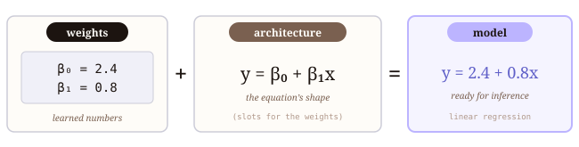
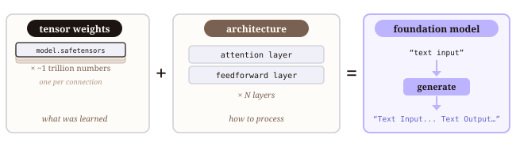
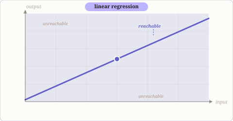
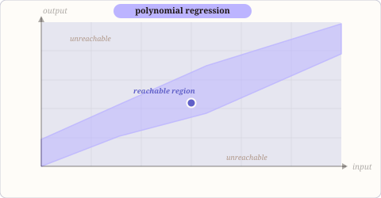
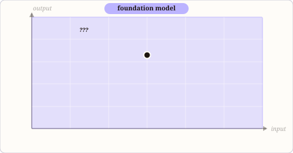

## What is a model?

Models are an abstraction of a process. I [wrote a blog about 7 years ago](https://www.kdnuggets.com/2019/06/all-models-are-wrong.html) (which is so old it has lost its images, yikes) centered around the George Box quote "Essentially, all models are wrong, but some are useful" that I think captures this concept pretty well.

The headline is that models are not the thing themselves; they are a representation. We start with assumptions and then adjust the variables within those assumptions until they more or less approximate whatever we think the underlying relationship is. The massaging is done by trying to home in on patterns we see within data.

I like starting with the idea that a model is a representation because it grounds us in the goal of a model, which helps contextualize what a model is in practice. For machine learning models, the representation of whatever process it is trying to replicate or abstract is captured as a mathematical function and a set of weights (numbers) that best approximate the underlying relationship between inputs and outputs.

For example, a linear regression model can be represented by the equation:

$$ y = \beta_0 + \beta_1 x_1 $$

The model's weights (the $\beta$ values, also known as coefficients) are learned (or fit) from data by adjusting those values until the outputs produced by the function match the known or expected values from the data as closely as possible. The function is defined prior to this training process, and the weights are learned.

The function in tandem with the weights determine how the input features ($x$ values) of a trained model are combined to produce the output ($y$ value). So, when we ship (publish) a linear regression, we are shipping both the function and the learned weights, which together define the model's behavior.

{fig-align="center" width="100%"}

## The components of a foundation model

Like a linear regression, a foundation model is a package, not a single thing. It contains several components that work together to process inputs and generate outputs. When you "ship" a foundation model, you are shipping all of these components, which together define the model's behavior. You can see all of them in the files of the [Mistral-Large-4-1T-A52B repository](https://huggingface.co/mistralai/Mistral-Large-4-1T-A52B/tree/main) on Hugging Face, which I'll use as a running example.

### Architecture

The architecture is the code that defines how data (in the shape of tensors) flows through the model. That code lives in a framework library (e.g., the Mistral model classes in Hugging Face Transformers), not in the model repository itself. What the repository ships are JSON files that *parameterize* the architecture: how many layers, how wide each layer is, how many attention heads, and so on.

- **`config.json`:** Contains the hyperparameters that define the model's shape (e.g., number of layers, hidden size, attention heads, vocabulary size) in Hugging Face's format. When you call `AutoModelForCausalLM.from_pretrained()` (or another `AutoModel` class), this file tells the library which Python class to instantiate (for this model, `MistralLarge4ForConditionalGeneration`) and with what configuration.

- **`params.json`:** A Mistral-native format that predates their Hugging Face integration. It contains the same kind of architectural settings (`dim`, `n_layers`, `n_heads`, `vocab_size`, plus mixture-of-experts settings like `num_experts`) in the format used by Mistral's own inference tooling.

### Weights

The weights are the learned parameters of the model; these are the actual numbers that encode what the model "knows." Roughly speaking, they are the strengths of the connections between neurons, plus a smaller number of embedding and normalization parameters.

Mistral-Large-4 has about **1 trillion** weights. It is a *mixture-of-experts* model: each layer contains 128 smaller "expert" networks, and only a handful of them run for any given token. That's what the "A52B" in the name means: roughly 52 billion parameters are *active* per token, but all 1 trillion have to be shipped and loaded. Modern models typically store weights as 16-bit `bfloat16` numbers, but this one stores most of them in 8-bit floating point (FP8) to halve the size. Even so, the weights add up to about 1 TB, split across 54 `.safetensors` files of roughly 20 GB each.

The `.safetensors` format has replaced the older `.bin`/`.pt` format because PyTorch's native format is built on Python's pickle, which allows arbitrary code execution on load (which anyone who has worked with pickle files knows makes security teams deeply uncomfortable).

- **`consolidated.safetensors.index.json`:** An index mapping each parameter name (e.g., `layers.0.attention.wq.weight`) to the shard file that contains it, so the runtime can load each layer's weights from the correct file. These are Mistral-native parameter names; a repository in Hugging Face's native format would use a `model.safetensors.index.json` file with names like `model.layers.0.self_attn.q_proj.weight` instead.

{fig-align="center" width="100%"}

In our example linear regression, we are operating exclusively on numbers; we feed numbers in as an input and expect numbers back as an output. This means that we only require the two core components for inference: the architecture and the weights.

To be useful in deployment, foundation models have to bridge between human-readable modalities (e.g., text and images) and the numeric tensors the model operates on. For text, the round trip looks like this: text → token IDs → embeddings → the model's layers → a probability for every token in the vocabulary → a sampled token ID → text. The remaining components of the package handle the ends of that pipeline.

### Tokenizer

The tokenizer converts raw text (strings) into integer token IDs the model can process, and maps the model's output IDs back into human-readable text. I'll write more about tokenizers in a future post, but what you should know here is that the tokenizer is a separate component from the model itself, with its own configuration and vocabulary files. Its job is to convert between human-readable text and the model's internal representation of that text as a sequence of integers.

- **`tokenizer_config.json`:** Specifies the tokenizer class and special tokens (`<s>`, `</s>`, `[INST]`, etc.).

- **`tokenizer.json`** and **`tekken.json`:** The vocabulary itself, in Hugging Face's format and Mistral's native format respectively. Tekken is Mistral's BPE tokenizer, and the file is the full lookup table mapping subword strings to integer IDs.

- **`chat_template.jinja`:** A template defining how a conversation (system prompt, user turns, assistant turns) gets formatted into a single string with the right special tokens before tokenization.

### Image processor

The image processor handles converting raw pixels into a format the model can consume: resizing, normalizing pixel values, and splitting the image into patches that get embedded alongside text tokens. This is only relevant for multi-modal models that can process images, but the concept is the same as the tokenizer: it bridges between human-readable input and the model's internal representation.

- **`processor_config.json`:** Defines the image resizing rules, normalization parameters (mean and standard deviation per color channel), and patch size (14×14 pixels for this model).

### Generation settings

These are settings for output generation that sit on top of the model rather than inside it, controlling how the runtime samples from the probability distribution the model produces at each step. They are *defaults*: whoever calls the model can override them on each request. The same model can generate very different output depending on these settings.

- **`generation_config.json`:** Defines the default sampling strategy. It can include temperature, top-p, top-k, repetition penalty and maximum output length; this model's file sets a temperature of 1.0 and a top-p of 0.95.

## The executable model in memory

A runtime loader assembles all of these components into an executable model in memory. This requires a code framework, for example [Hugging Face Transformers](https://github.com/huggingface/transformers), a Python library built on PyTorch that contains architecture code for most open foundation models.

Here is what that assembly looks like in practice. I'm using a much smaller Mistral model in this example, since a 1 TB model won't load on your laptop:

```python
from transformers import AutoModelForCausalLM, AutoTokenizer

# reads config.json, instantiates the right Python class, loads weights
model = AutoModelForCausalLM.from_pretrained("mistralai/Mistral-7B-v0.1")

# reads tokenizer_config.json, loads vocab and merge rules
tokenizer = AutoTokenizer.from_pretrained("mistralai/Mistral-7B-v0.1")
```

`from_pretrained()` reads `config.json` to determine the model class (here, `MistralForCausalLM`), instantiates it with the right hyperparameters, then loads the weights from the `.safetensors` files into that object's parameters. At that point you have a live function you can feed input to and get output from.

For production serving, inference engines like [vLLM](https://docs.vllm.ai) and SGLang maintain their own implementations of each architecture, built on optimized GPU kernels — same math, rewritten to squeeze out throughput. The reference implementation usually lives in Transformers, though some labs (Mistral included) also publish their own reference inference code.

```{=html}
<figure class="figure" style="text-align:center;">
  <video src="figures/voltron.mp4" poster="figures/voltron-poster.jpg" width="480" autoplay loop muted playsinline style="max-width:100%; height:auto;" aria-label="Animated clip of the Voltron robot assembling"></video>
  <figcaption style="color:#7A6050;">Weights loaded. Config applied. Tokenizer attached. Forward pass ready. Form Voltron.</figcaption>
</figure>
```

## Models are grown, not built

You may have come across the phrase "AI is grown, not built" in reference to foundation models. I'd argue that this is true of every machine learning model: all of them are grown from data. What changes is how much room the architecture gives them to grow.

The difference between smaller machine learning models and foundation models lies in the assumptions of the architecture and the scale of the data. A linear regression assumes a linear relationship between input and output; we can intuitively understand the shape of the transformation it applies, and therefore anticipate the possible range of outputs the model can produce. A prediction made by a trained linear regression will always lie somewhere on the line defined by its weights.

Every architecture of a machine learning model defines a **reachable space**: the set of all input-output relationships the model is capable of expressing, across every possible setting of its weights. (In the machine learning literature this is called the *hypothesis space*.) For a linear regression, that's the set of all possible lines, or hyperplanes when there are multiple inputs. Training picks one of them. When we use a linear regression, we are making a strong and explicit assumption that the shape of the process we are trying to model is linear.

{fig-align="center" width="100%"}

When we add complexity to the architecture of a machine learning model (e.g., polynomial regression, decision trees, a shallow neural network), the reachable space expands.

The model can now follow curves, capture interactions, fit non-linear patterns. The region of possible outputs is larger than a line. But it is still bounded: the architecture's assumptions still constrain what shapes the model can produce. For example, a polynomial must be globally smooth, and a decision tree makes piecewise constant jumps that can be traced through thresholds in the data.

{fig-align="center" width="100%"}

In a foundation model, the architecture is deliberately _very_ general. The weights don't fit a relationship that has been pre-specified; they learn *what kind of function to be* depending on context. A linear regression's reachable space is a line, bounded and fully describable. A decision tree's is piecewise constant, traceable through its thresholds. A transformer's is high-dimensional and deeply non-linear, which makes it difficult to understand or describe what that reachable space might be.

{fig-align="center" width="100%"}

This is what "grown, not built" actually means. The architecture of any model is the petri dish we are growing knowledge in. The data is the agar, and the models that result are the little mold cultures.

```{=html}
<div id="petri-root"></div>
<script type="module" src="./petri/dishes.js"></script>
```

<p style="font-size:0.82em; color:#7A6050; margin-top:0.5em;">Petri dish visualization inspired by <a href="https://www.adailydish.com/?view=flipcard" style="color:#7A6050;">A Daily Dish</a> and <a href="https://www.instagram.com/p/CtL8iF7KOVs/?img_index=1" style="color:#7A6050;">this Instagram post</a>.</p>

What comes out is something researchers have optimized toward but didn't fully design — and increasingly, [don't fully understand](https://www.theatlantic.com/technology/2025/09/if-anyone-builds-it-excerpt/684213/).


## Further reading

- [Hugging Face Transformers — Model documentation](https://huggingface.co/docs/transformers/models)
- [vLLM documentation](https://docs.vllm.ai)
